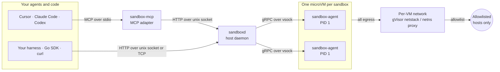

<p align="center">
  <a href="https://tryboxi.xyz">
    
  </a>
</p>

<h1 align="center">
  <a href="https://tryboxi.xyz">tryboxi</a>
</h1>

<p align="center">
  <a href="LICENSE"></a>
  <a href="https://tryboxi.xyz"></a>
</p>

<p align="center">
  <b>Disposable Linux microVMs on your own machine, for AI agents.</b>
</p>

<p align="center">
  Create a sandbox, run commands, read stdout / stderr / exit code, throw it away.<br />
  Think "E2B, but on your computer": code never leaves the machine and it costs $0.
</p>

## Intro

- **A real Linux machine per agent.** Each sandbox is an Ubuntu 24.04 microVM with its own kernel.
- **Your repo goes in one way.** Changes come back only through `diff` / `apply` / `pull`, with a backup and `undo`.
- **Secrets never enter the VM.** The VM sees placeholders; an egress proxy swaps in the real value for allowed hosts.
- **Allowlist-only network** with presets, a setup phase, and "ask to allow" from the agent.
- **Fast.** Warm pool, golden snapshots, pause to disk, fork, and restore.
- **Works with Cursor, Claude Code, and Codex** over MCP, or with anything that speaks HTTP.
- **Observable.** Prometheus metrics, OpenTelemetry traces, and a Grafana dashboard.

## Project Structure

```text
tryboxi/
├── cmd/                     # entry points
│   ├── sandboxd/            # host daemon
│   ├── sandboxctl/          # CLI (incl. `mcp install`)
│   ├── sandbox-mcp/         # MCP stdio adapter
│   └── sandbox-agent/       # guest agent, PID 1 in every VM
├── guest/                   # code that runs inside the VM
│   ├── initd/               # initramfs switch_root and mounts
│   ├── proc/                # PID 1 reaper
│   ├── execd/               # exec, PTY, timeouts
│   ├── spool/               # unacked output spool
│   ├── files/               # file reads and writes
│   └── server/              # gRPC server over vsock
├── internal/                # host-side packages
│   ├── api/                 # HTTP router
│   │   ├── middleware/      # peer creds, token, Origin/Host checks
│   │   └── sse/             # server-sent events
│   ├── service/             # use cases: create, exec, sync, diff, apply, pull, undo,
│   │                        # snapshots, fork, restore, recover, warm pool, templates, GC
│   ├── scheduler/           # vCPU / memory ledger, fair queue, memory pressure
│   ├── vmm/                 # VM driver interface
│   │   ├── vz/              # macOS Virtualization.framework
│   │   └── firecracker/     # Linux Firecracker
│   ├── network/             # egress control
│   │   ├── policy/          # allow / deny engine
│   │   ├── dns/             # policy-aware resolver
│   │   ├── sniff/           # SNI / Host sniffing
│   │   ├── egress/          # proxy, secret swap, git proxy
│   │   ├── usernet/         # macOS gVisor userspace network
│   │   └── linuxnet/        # Linux netns + nftables
│   ├── workspace/           # delta sync, .git sanitizing, 3-way apply, pull, backup / undo
│   ├── output/              # log files, ring buffers, SSE fan-out, ANSI cleanup, grep
│   ├── store/               # SQLite (WAL) + migrations
│   │   └── db/              # sqlc-generated queries
│   ├── safefs/              # the only code path that deletes outside the data root
│   ├── secrets/             # host-side secret storage
│   ├── telemetry/           # metrics and tracing
│   └── ...                  # backend, config, events, guestclient, ids, image, platform, version
├── pkg/
│   └── client/              # public Go SDK
├── proto/guest/v1/          # guest.proto (host <-> guest contract)
├── gen/guest/v1/            # generated gRPC code
├── api/                     # openapi.yaml (HTTP contract)
├── agent-rules/             # rule / skill text installed for harnesses
├── migrations/              # SQL migrations
├── queries/                 # sqlc queries
├── images/base/             # base rootfs Dockerfile
├── scripts/
│   ├── images/              # kernel fetch, rootfs build
│   └── dev/                 # Lima + dev loop
├── deploy/
│   ├── lima/                # nested-virt Lima VM for the Firecracker backend
│   ├── observability/       # Prometheus + Grafana + Jaeger (docker compose)
│   └── grafana/             # dashboard JSON
├── examples/
│   ├── go-harness/          # Go SDK example
│   └── python-harness/      # stdlib Python over the socket
├── test/
│   ├── e2e/                 # real microVM tests
│   ├── fixtures/            # sample repos
│   └── spike/               # early experiments
├── docs/                    # TESTING.md
└── web/                     # tryboxi.xyz landing page (Next.js, bun)
```

## Platform support

| Host | Backend | Status |
| --- | --- | --- |
| macOS 14+ on Apple Silicon | Apple Virtualization.framework, VMs hosted in the daemon | Working |
| Linux (KVM) | Firecracker + per-VM network namespaces | Compiles and is unit-tested; real-VM testing happens in Lima |
| Windows | None yet (would need Hyper-V / WSL2) | Not supported |

## Performance

Measured on an M4 MacBook (16 GB, macOS 26.5).

| Operation | Time |
| --- | --- |
| Create a sandbox from the warm pool | 20–50 ms |
| Create from a golden snapshot (incl. workspace sync) | 0.5–0.6 s |
| Resume a sandbox paused to disk | 0.5–0.7 s |
| Fork a running sandbox (per clone, parallel) | ~0.8 s |
| Cold boot to guest agent ready | 1.2 s |
| Golden snapshot of the base image | 0.3–0.8 s |
| `exec` round trip for a trivial command | a few ms |

## Quick start

> A step-by-step guide with more detail lives in [docs/TESTING.md](docs/TESTING.md).

**Requirements:** an Apple Silicon Mac on macOS 14+, Go, and Docker Desktop (only to build the base image once).
At runtime no Lima, Docker, or root is needed.

### 1. Build

```bash
git clone https://github.com/karthikponna/tryboxi && cd tryboxi
make images   # guest kernel (Kata 6.12, sha256 pinned) + Ubuntu 24.04 rootfs, built in Docker (~3 min)
make build    # sandboxd (signed), sandboxctl, sandbox-mcp, and the Linux guest agent
```

Everything lands in `_out/` (git-ignored).

### 2. Install and start the daemon

```bash
# Option A: background service that starts at login (LaunchAgent)
./_out/bin/sandboxd install --artifacts _out

# Option B: foreground, best while testing (Ctrl-C pauses sandboxes to disk)
./_out/bin/sandboxd install --artifacts _out --no-service
./_out/bin/sandboxd serve
```

### 3. Check it

```bash
./_out/bin/sandboxd doctor     # host checks: macOS, entitlement, APFS, artifacts, socket
./_out/bin/sandboxctl doctor   # daemon health and capacity
```

Tip: put the binaries on your `PATH`:

```bash
ln -s "$PWD/_out/bin/"{sandboxd,sandboxctl,sandbox-mcp} ~/.local/bin/
```

### 4. Try it

```bash
ID=$(sandboxctl create -w ~/code/my-app | awk '{print $1}')   # sbx_...
sandboxctl exec $ID -- npm test     # the repo is synced in before every exec
sandboxctl diff $ID                 # what changed inside the VM
sandboxctl apply $ID                # bring it back, with a backup
sandboxctl rm $ID
```

## Connect your agent (MCP)

`sandbox-mcp` is an MCP server over stdio. `sandboxctl mcp install` writes the MCP config **and** the
agent rules that tell the agent when to use the sandbox. Make sure the daemon is running first.

### Cursor

```bash
sandboxctl mcp install cursor --project /path/to/your/repo
# or for every project
sandboxctl mcp install cursor --global
```

This writes:

| File | Purpose |
| --- | --- |
| `.cursor/mcp.json` (or `~/.cursor/mcp.json` with `--global`) | Adds the `sandbox` server |
| `.cursor/rules/sandbox.mdc` | Always-applied rule describing when to use the sandbox |

Then open **Cursor Settings → MCP**, enable `sandbox`, and reload the window if it is not listed.

<details>
<summary>Manual config</summary>

```json
{
  "mcpServers": {
    "sandbox": {
      "command": "/path/to/tryboxi/_out/bin/sandbox-mcp",
      "args": [],
      "env": { "SANDBOX_WORKSPACE": "${workspaceFolder}", "SANDBOX_CLIENT": "cursor" }
    }
  }
}
```

</details>

### Claude Code

```bash
sandboxctl mcp install claude --project /path/to/your/repo
# --global installs for your user instead (claude mcp add --scope user)
```

This writes `.claude/skills/sandbox/SKILL.md` and registers the server with the `claude` CLI.
If `claude` is not on your `PATH`, the command is printed so you can run it yourself:

```bash
claude mcp add --scope project --env SANDBOX_CLIENT=claude sandbox -- /path/to/tryboxi/_out/bin/sandbox-mcp
```

Inside Claude Code, run `/mcp` to confirm the `sandbox` server is connected.

### Codex

```bash
sandboxctl mcp install codex --project /path/to/your/repo
```

This appends the server to `~/.codex/config.toml` (a backup is kept as `config.toml.bak`):

```toml
[mcp_servers.sandbox]
command = "/path/to/tryboxi/_out/bin/sandbox-mcp"
args = []
env = { SANDBOX_CLIENT = "codex" }
startup_timeout_sec = 30
tool_timeout_sec = 900
```

and writes the sandbox rules to `AGENTS.md` in your project (appending if the file exists, with a backup).

### Options

These flags work with all three harnesses. They are set by you, not chosen by the model.

| Flag | What it does |
| --- | --- |
| `--project <dir>` | Project to configure (default: current directory) |
| `--global` | Install for your user instead of one project (Cursor and Claude Code) |
| `--auto-pull` | Copy changed manifests and lockfiles back to the host automatically, with a backup |
| `--setup "npm ci"` | Run a setup command once per sandbox with open network, then lock down (separate several with `;;`) |
| `--secrets NAME,NAME` | Bind stored secrets to every sandbox (the VM only sees placeholders) |

### MCP tools

| Tool | What it does |
| --- | --- |
| `sandbox_exec` | Run a shell command in the microVM (repo mirrored at `/workspace`, synced before every run) |
| `sandbox_read_file` | Read a file from inside the sandbox |
| `sandbox_write_file` | Write a file inside the sandbox only |
| `sandbox_diff` | Show changes in `/workspace` relative to its git `HEAD` |
| `sandbox_apply` | Merge the sandbox's changes into your repo (3-way, with a backup) |
| `sandbox_pull` | Copy files commands changed (formatters, lockfiles, codegen) back to your repo |
| `sandbox_snapshot` | Checkpoint, restore, fork, or list snapshots |
| `sandbox_network` | Ask to open network access to a blocked host (you approve the call) |
| `sandbox_port` | Expose a server's port on the host's `127.0.0.1` |
| `sandbox_status` | Show the session's sandbox and host capacity |
| `sandbox_destroy` | Destroy the sandbox and free its memory |

### Try these prompts

- "Run the test suite in the sandbox and fix any failures."
- "Install the dependencies and start the dev server in the sandbox, then give me the URL."
- "In the sandbox, run `npm run lint -- --fix` and pull the changed files back."
- "Checkpoint the sandbox, try upgrading all dependencies, run the tests; if they fail, restore."

Watch what the agent does live with `sandboxctl events`.

## Use it from your own code

The API is plain HTTP/JSON on a unix socket. The contract is in [`api/openapi.yaml`](api/openapi.yaml)
(also served at `GET /v1/openapi.yaml`).

**curl**

```bash
S="$HOME/Library/Application Support/sandboxd/sandboxd.sock"
curl -s --unix-socket "$S" -X POST http://localhost/v1/sandboxes \
  -d '{"workspace":{"host_path":"'$PWD'"},"template":"auto"}'
curl -s --unix-socket "$S" -X POST http://localhost/v1/sandboxes/$ID/exec -d '{"cmd":"npm test"}'
curl -s --unix-socket "$S" -X DELETE http://localhost/v1/sandboxes/$ID
```

**Go** uses the SDK in [`pkg/client`](pkg/client); see [`examples/go-harness`](examples/go-harness).

**Python** works with the standard library or `httpx` over the socket; see [`examples/python-harness`](examples/python-harness).

**Over TCP** (containers, other users, other languages): set `tcp_listen: 127.0.0.1:7070` in
`~/Library/Application Support/sandboxd/config.yaml`, restart, and send `Authorization: Bearer $(sandboxd token)`.

## CLI reference

### `sandboxctl`

| Area | Commands |
| --- | --- |
| Sandboxes | `create` `ps` `rm` `pause` `resume` `shell` `port` `top` |
| Commands | `exec` `logs` `grep` |
| Files and repo | `sync` `cp` `diff` `apply` `pull` `undo` `artifacts` |
| Snapshots | `snapshot` `fork` `restore` `recover` |
| Network and secrets | `net` `secret` |
| Observability | `events` `trace` |
| Housekeeping | `templates` `gc` `doctor` |
| Harnesses | `mcp install cursor \| claude \| codex` |

### `sandboxd`

| Command | What it does |
| --- | --- |
| `install --artifacts _out` | Copy the kernel, guest agent, and rootfs into the data root; set up the LaunchAgent |
| `serve` | Run the daemon in the foreground |
| `doctor` | Check the host |
| `config` | Print the effective configuration |
| `token` | Print the API bearer token for TCP or forwarded-socket clients |
| `uninstall` | Remove the service, keep data (`--purge` deletes it, after confirmation) |
| `version` | Print the version |

## How it works



Your agent never talks to a VM directly. It calls `sandboxd`, which boots or reuses a microVM, syncs your repo
in, and runs the command through the guest agent. Every packet a VM sends goes through its own network
stack and the egress policy, so only allowlisted hosts are reachable.

| Binary | What it does |
| --- | --- |
| `sandboxd` | Host daemon: HTTP API on a unix socket (optional TCP + token), scheduler, VM drivers, snapshots, workspace sync, egress policy |
| `sandbox-agent` | Static Linux binary, PID 1 in every VM (delivered via a tiny initramfs), gRPC over vsock |
| `sandbox-mcp` | MCP stdio adapter for Cursor, Claude Code, and Codex |
| `sandboxctl` | The CLI |

Data lives in `~/Library/Application Support/sandboxd/` (macOS) or `/var/lib/sandboxd` (Linux), never in your repo.

### Observability

- `sandboxctl trace <sbx_id|exe_id>` prints a per-phase waterfall (`scheduler.reserve`, `vm.restore`, `guest.configure`, `workspace.sync`, `exec`, ...).
- `sandboxd serve --otlp-endpoint http://127.0.0.1:4318` also exports spans to Jaeger, Grafana Tempo, or any OpenTelemetry collector.
- Prometheus metrics are at `/metrics`; import [`deploy/grafana/sandboxd-dashboard.json`](deploy/grafana/sandboxd-dashboard.json) into Grafana, or start the stack in [`deploy/observability`](deploy/observability).

## Data safety

These rules are enforced in code:

- **Sync is one-way, host to VM.** Deleting files inside a VM never deletes anything on the host.
- **The daemon writes to your repo only through `apply` and `pull`.** Both back up every file they are about to change; `sandboxctl undo <artifact_id>` restores it.
- **`apply` and `pull` are careful.** They reject absolute paths, `..`, symlinks that escape the repo, and anything under `.git/`. They never commit, switch branches, reset, clean, or touch the git index (3-way merges use `git merge-file` on temp files). `pull` refuses to overwrite a host file that changed since the last sync unless forced.
- **Deletes are fenced.** Every delete goes through `safefs.RemoveUnder(root, path)`, which resolves symlinks and refuses anything outside the daemon's data root.
- **No shared folders.** No host folder is ever shared into a VM (no virtio-fs); files move only by explicit copy over vsock.
- **Secrets are not synced by default** (`.env*`, `*.pem`, `*.key`, `id_*`, `.npmrc`, `.aws`, `.ssh`, ...), and the copied `.git/config` has credential helpers, auth headers, includes, and URL credentials stripped.
- **Credentials never enter VMs.** Stored secrets reach a sandbox only as placeholders. The egress proxy swaps in the real value for the secret's hosts (TLS terminated with a local CA), scrubs echoed values from responses, and blocks placeholders sent anywhere else. A git proxy adds the git token only for allowed repos and refuses pushes outside allowed branches. Commands, env, stdin, and synced files that contain a stored secret value are rejected.
- **Egress is allowlist-only by default** (package registries, GitHub, Ubuntu mirrors). Host loopback, LAN, link-local/metadata, and CGNAT ranges are always blocked, and DNS answers pointing there are dropped.
- **Uninstall keeps data** unless `--purge` is passed and confirmed. GC supports `--dry-run`, and every deletion is logged as an event.

## Development

| Command | What it does |
| --- | --- |
| `make images` | Fetch the kernel and build the base rootfs (Docker) |
| `make build` | Build all binaries for this host (signs `sandboxd` on macOS) |
| `make test` | Unit tests |
| `make lint` | `go vet` (host + linux/arm64) and `gofmt` |
| `make e2e-darwin` | Real microVM tests on this Mac (needs `make images`) |
| `make test-linux` | Guest process tests in a Linux container |
| `make proto` / `make sqlc` | Regenerate gRPC and SQL code |

See [CONTRIBUTING.md](CONTRIBUTING.md) for the full workflow.

The website lives in [`web/`](web): `cd web && bun install && bun run dev`.

## License

This repository's source code is available under the [MIT License](LICENSE). You are free to clone, use,
modify, and distribute it, including commercially, as long as the copyright notice is kept.
